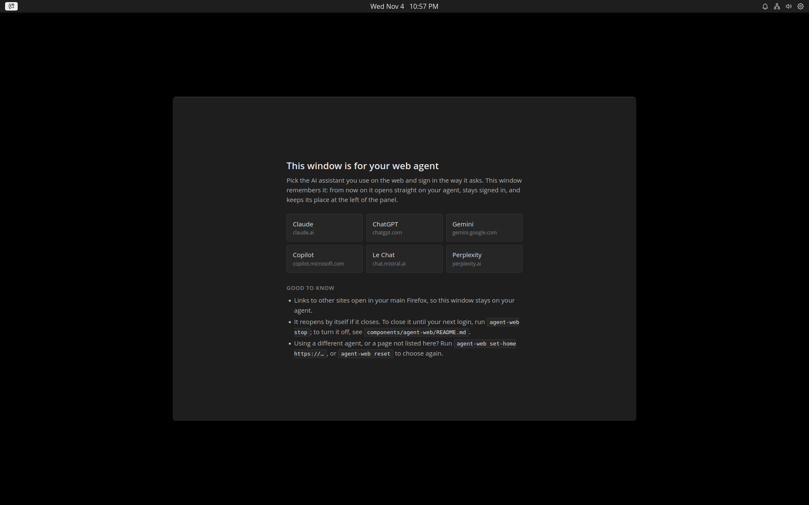
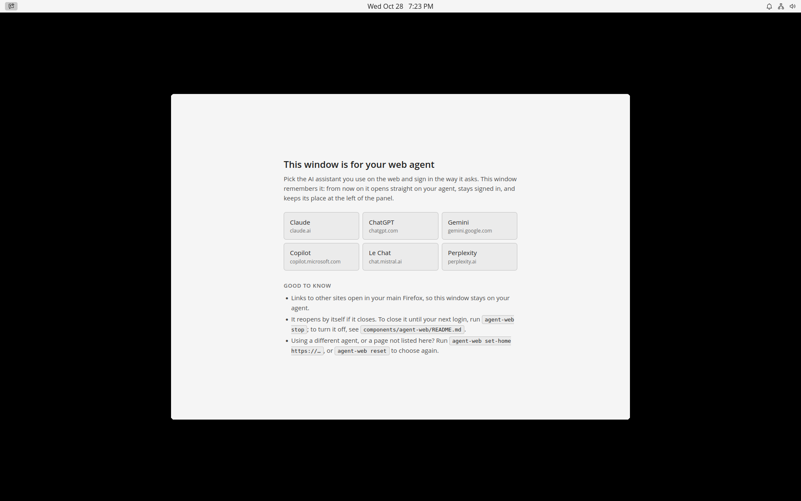
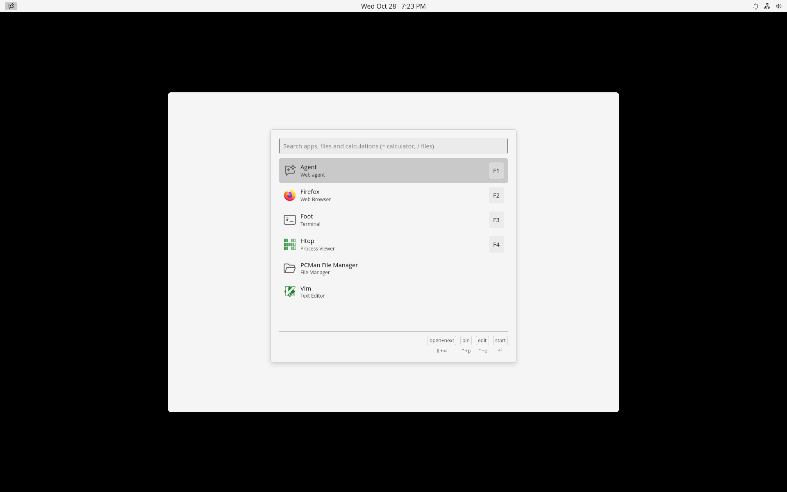
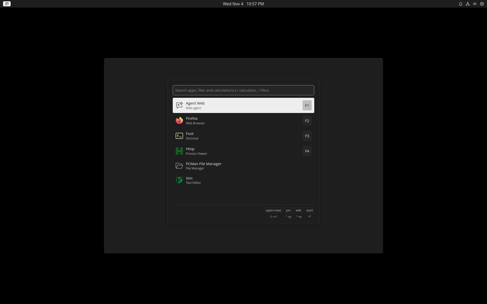
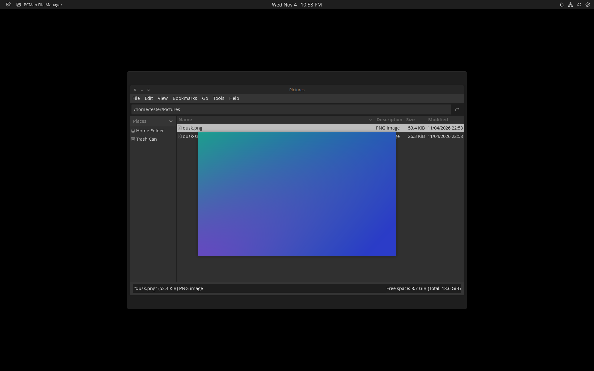
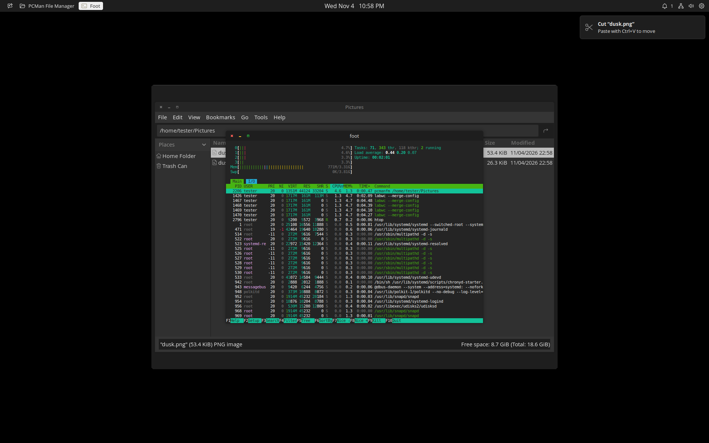
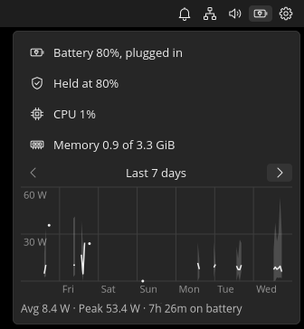
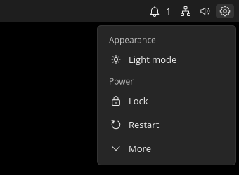

# limDE

**limDE — less is more.** A small labwc desktop for Ubuntu Server (and, newly, Arch Linux).

A small Wayland desktop for Ubuntu Server: labwc, a compact panel (Tinybar), the Walker
launcher, a consistent dark or light theme, Space-bar file preview in PCManFM, and a persistent
window for a web-based AI agent, or a terminal for a command-line one. Install Ubuntu Server
26.04, clone this repository, run `./install`, and log in. Arch Linux works the same way
([Installing on Arch](docs/ARCH-INSTALL.md)); it is newer and tested in VMs only.

Dark and light are both complete themes: the panel, launcher, file manager, notifications,
window borders and app icons all follow the one you pick (only foot's terminal colours stay
dark), and `scripts/check` holds both to WCAG 2.2's contrast minimums.

It's made for laptops first: careful with the battery, with trackpad motion and scrolling
modelled on a MacBook's.

> **Status: beta (`v1.0.0-beta.5`).** It's in daily use on one laptop, and installs from
> scratch have only been tested in QEMU and from a USB stick on that same laptop; Arch
> installs only in QEMU. Expect rough edges, and see [Known gaps](#known-gaps).

## Screenshots



| | |
| --- | --- |
|  |  |
| **Light theme:** the same first login with `mode = "light"`. | **Launcher, light:** app icons keep their own colours, shaded to suit each theme. |
|  |  |
| **Launcher:** Super+Space opens Walker for apps, files and sums. | **Files:** select a file in PCManFM and press Space to preview it. |
|  |  |
| **Terminal and notifications:** foot with htop, and a notification after a file is cut. | **Lock:** Super+L, or after 5 idle minutes. |

| | |
| --- | --- |
|  |  |
| **Battery:** click the battery for its state and charge limit (draw and time left when on battery), CPU and memory, above its draw over the last 3 hours, 24 hours or 7 days. | **System menu:** the cog at the right end switches between light and dark, and locks or restarts; More has Suspend, Log out and Power off. |

Screenshots are from a clean install in a VM at 1920×1200, except the battery graph,
which needs a real battery and comes from a laptop.

## Philosophy

Two goals shaped limDE from the start, and they come before everything else:

- **Keep battery drain low, and visible.** On a laptop, every background process,
  wake-up and service costs battery life. limDE starts only what the desktop needs (no
  display manager, no extra services, no recommended-package extras), and it puts the
  numbers in front of you: Tinybar shows the battery's live draw in watts and the hours
  left, and colours the battery icon as the draw climbs, so you can see how fast the
  battery is draining and notice when the draw jumps. Hover over the battery for CPU
  and RAM use too, and click it for a graph of the draw over the last 3 hours, 24 hours
  or 7 days. After 5 idle minutes the screen locks, and after 8 a laptop on battery
  suspends.
- **Trackpad motion and scrolling that feel like a MacBook.** Slow, precise pointer
  movement that speeds up smoothly, and two-finger scrolling that follows your fingers.
  That needs labwc's custom acceleration and scroll curves (labwc 0.20.3 and later),
  which is why labwc is built from source: Ubuntu 26.04's labwc package is older.
  limDE ships tuned curves, turned on for touchpads.

Memory use, measured on the Dell XPS 15 9520 described under
[Known gaps](#known-gaps) with only the agent window open (proportional set size, so
shared pages are split between the processes that use them):

| | Memory |
| --- | --- |
| The desktop: labwc, Tinybar, Walker and Elephant, Mako, swayidle | about 240 MiB |
| Session services: PipeWire, D-Bus, keyring, GVfs, the user's systemd | about 50 MiB |
| The agent window (Firefox, just started on a new claude.ai conversation) | about 1.1 GiB |
| The whole system in use, including a Claude Code CLI session | about 3.0 GiB of 16 GB |

Most of it is the browser, and it grows with the conversation: with one long claude.ai
conversation the agent window took 1.2 to 1.8 GiB, and Firefox keeps that memory until the
window restarts (`limde-agent restart`). The desktop itself is a few hundred MiB.

And three habits that follow from those goals:

- **Minimal, but not dogmatic.** The installer lists every package it wants, with the
  reason for it, before installing anything. Optional pieces are optional, and you choose
  them.
- **Built from source only where it matters.** labwc is built from a pinned upstream
  release, for the curves above. Everything else comes from Ubuntu or from pinned upstream
  releases.
- **Yours to change.** Shipped defaults sit apart from your own changes, so updates
  don't overwrite them.

## Install

You need a fresh **Ubuntu Server 26.04** (x86_64) install, a normal user with `sudo`, and a
network connection. Choose no extra snaps or server roles in Ubuntu's installer;
[Installing Ubuntu Server](docs/SERVER-INSTALL.md) goes through its screens.

Only 26.04 is supported: it is a long-term support release and the only one limDE is
tested on, so the installer refuses any other version, 26.10 included.

On **Arch Linux**, start from archinstall's minimal profile with NetworkManager instead;
[Installing on Arch](docs/ARCH-INSTALL.md) has the steps, and the rest below is the same.
Until Arch's stable labwc reaches 0.20.3, the touchpad keeps libinput's standard motion and
scrolling (limDE's curves need 0.20.3) and switches over by itself on the next `./install`.

1. Log in on the text console and clone this repository:

   ```
   git clone https://github.com/kgagne/limde.git
   cd limde
   ```

2. See the plan without changing anything:

   ```
   ./install --plan
   ```

3. Install. The installer shows each package and its reason, asks about the optional
   parts, then installs. labwc and PCManFM are built from source and the launcher is
   downloaded as a release, which takes a while (about 20–40 minutes on a slow disk).

   ```
   ./install
   ```

4. Log out and back in on tty1. labwc starts by itself; there is no display manager.

The installer needs a working network connection. Once the desktop is running, join
Wi-Fi from the Wi-Fi icon in the panel; NetworkManager remembers it after that.

### Optional parts

| Group | Adds | Pick it when |
| --- | --- | --- |
| `bluetooth` | BlueZ, PipeWire's Bluetooth audio | you use Bluetooth headphones, speakers, keyboards or mice; the panel then shows a Bluetooth menu |
| `laptop` | `brightnessctl` and its udev rule, `powertop`, `smartmontools` | the machine has a screen backlight; without it the brightness keys do nothing |
| `papers` | GNOME Papers | you want a PDF and document viewer |
| `printing` | CUPS, Avahi | you print, including to network printers |

The interactive installer suggests `laptop` when it finds a backlight, and `bluetooth`
when it finds a Bluetooth adapter. For unattended installs, name the groups yourself:

```
./install --yes --with=laptop,papers
```

If you install from a VM onto a USB stick or another disk for a laptop, add
`--with=laptop`: the VM has no backlight, so it won't be suggested.

### Documentation

- [Installing Ubuntu Server](docs/SERVER-INSTALL.md): Ubuntu's installer screen by
  screen, and the server services a laptop can do without.
- [Installing](docs/INSTALL.md): every step, the questions, the network switch, and
  what to do when a step fails.
- [Battery life](docs/BATTERY.md): what limDE does for the battery and how to see what
  uses power.
- [Trying it in a VM](docs/VM-TRIAL.md): a trial run before you install on hardware.
- [Dependencies](docs/DEPENDENCIES.md): every package and pinned download, and why.
- [Customizing](docs/CUSTOMIZE.md): where defaults and your own files live, and what
  each setting does.
- [Updating](docs/UPDATE.md): `limde-update`, releases, and going back.
- [Recovery](docs/RECOVERY.md): when the desktop does not start, or an update goes wrong.

## Using it

| Keys | Does |
| --- | --- |
| Super+Return | terminal (foot) |
| Super+Space | launcher (Walker): apps, files, calculator |
| Super+L | lock the screen |
| Super+W / Super+Q | close the tab or window / quit the app |
| Super+Escape | pass every key to the focused window (VMs, remote desktops); press again to undo |
| Alt+Super+H | move the pointer to the middle of the screen (done once at login) |
| Print / Shift+Print | screenshot a region / the whole screen, saved and copied |
| Ctrl+Print | copy a region to the clipboard only |
| Volume and brightness keys | change them, with a short readout in the panel |

In PCManFM, press Space to preview the selected files, or, with nothing selected, the
file under the keyboard focus outline.

### The agent window

The window at the left of the panel is your AI agent, kept open as part of the desktop
instead of as one tab among many. It runs in one of two modes, and `limde-agent mode web`
or `limde-agent mode cli` switches between them at once and for every login after:

- **web** (the default): **agent-web**, your web agent's site. On first start it shows a
  page of common web agents. Open yours and sign in. After that the window keeps to that
  site and sends every other link to your main Firefox.
- **cli**: **agent-cli**, a terminal on a command-line agent such as Claude Code, Codex
  CLI or Gemini CLI. The agent runs in tmux, kept going by a user service, so closing the
  window only hides it and the agent carries on. The first time, the window walks you
  through choosing the agent, shows its official install command if it is missing, and
  starts it (`limde-agent setup` runs that again).

In either mode the window reopens if it is closed, Super+W, Super+Q and Alt+F4 skip it,
and it stays leftmost in the panel. `limde-agent status` says what runs, and `limde-agent
stop` closes it until your next login.

It's meant for an agent you use all day: a chat you keep coming back to, or a
long-running session you check on and steer, such as a coding agent at work on this or
another machine. In web mode, `agent-web set-home URL` opens it straight on one page,
such as a particular session.

**Why not a desktop app?** Many web agents have no official Linux app, and the apps and
wrappers that do exist usually bundle their own browser engine to show the same website.
agent-web uses the Firefox that limDE already installs, in a separate profile. There is
nothing more to install or keep updated, you get the same features as the website, and the
agent's sign-in stays apart from your everyday browsing. It still uses a Firefox
process's memory while it's open. What a website can't do is reach your files, code or
system, which is the usual reason to want a desktop app. A command-line agent covers that
instead.

**Web and CLI together.** A command-line agent works directly in your code, files and
system, with its own permission prompts, and some can be driven from their website.
Claude Code, for example, has Remote Control: the setup offers to start it as `claude
--remote-control`, and the session then appears on claude.ai, where the agent window in
web mode can steer it, as can your phone. Switching modes never stops the CLI agent: it
keeps running in tmux, and `tmux -L agent attach` reaches it from any terminal. To keep it
running before you log in as well, run `loginctl enable-linger`. The CLI, its account and
its permissions are yours to choose; limDE installs none of them.

If you'd rather use a desktop app anyway, turn the agent window off as
`components/agent-web/README.md` describes.

## Customizing

Your own files override limDE's, and the installer never overwrites them. The exception
is the theme files it generates from your appearance settings, which it replaces and backs
up (listed in [docs/CUSTOMIZE.md](docs/CUSTOMIZE.md)):

- **labwc:** put only the settings you change in `~/.config/labwc/rc.xml`. labwc merges it
  over limDE's defaults in `/etc/xdg/labwc/`.
- **Session start:** add scripts to `~/.config/limde/autostart.d/`. A file with the
  same name as one of limDE's replaces it, and an empty one turns that piece off.
- **Theme:** colours, fonts and icons live in `~/.config/limde/appearance.toml`, which
  needs only the keys you change. `limde-appearance` shows what would change, and
  `limde-appearance --apply` writes it, backing up what it replaces. To switch between
  the light and dark themes, use the cog menu in Tinybar; it keeps your choice, which wins
  over any `mode` set in that file. Windows already open may keep some of the old theme
  until you reopen them. Both palettes
  meet WCAG 2.2's contrast minimums (4.5:1 for text, 3:1 for icons and control edges),
  and `scripts/check` keeps it that way.
- **Panel:** `~/.config/tinybar/settings.toml` (see `components/tinybar/README.md`).

## Working on limDE

`docs/CODEMAP.md` lists where each part lives (files and function names) and the traps
that cost time. `scripts/check` runs before every commit and fails if the map points at
something that no longer exists, so update it when you move or rename what it lists.

## Updating

```
limde-update --check
```

```
limde-update
```

`limde-update` fetches the newest limDE release into the clone you installed from, shows
its notes and what it will rebuild, and asks before it checks that release out and runs
`./install` with the optional parts you chose last time. It runs only when you run it.
`--main` follows the main branch instead of releases, and `--to TAG` installs a given
release, which is also how to go back to an earlier one. Ubuntu's own packages are
updated by apt as usual (Ubuntu Server installs unattended security updates).

Running `./install` again is always safe. Each step checks first and only changes what
is missing or out of date, including the pinned source builds in `pins/`. So `git pull`
followed by `./install` also works, for a clone that follows a branch.

## Known gaps

- In daily use on one laptop: a Dell XPS 15 9520 (Intel Core i7-12700H, 16 GB RAM,
  Intel Iris Xe plus an NVIDIA GeForce RTX 3050 Laptop GPU, 512 GB NVMe SSD). That
  laptop runs limDE's components with its owner's personal settings on top, including
  NVIDIA's own driver, so sound, suspend and resume, the lid and the battery readout are
  exercised there every day.
- Not yet tested from scratch on any other hardware. A fresh `./install` has been tested
  only in QEMU and from a USB stick booted on that same laptop, not on a laptop's
  internal drive.
- Arch Linux is tested only in QEMU (a fresh install, a second run, the desktop after a
  reboot). The acceptance, Wi-Fi and Bluetooth tests still run on Ubuntu only.
- The trackpad curves were tuned on one laptop's touchpad and may feel different on
  yours. To change them, copy the whole `<device category="touchpad">` block from
  `/etc/xdg/labwc/rc.xml` into `~/.config/labwc/rc.xml` and edit it there; your block
  replaces limDE's entirely. For libinput's default motion, use
  `<accelProfile>adaptive</accelProfile>` and remove the curve lines.
- Tinybar joins WPA/WPA2/WPA3 networks with a password and open networks. Hidden
  networks and work (802.1X) logins still go through `nmtui` ("Other network…" in the
  Wi-Fi menu).
- Tinybar's Bluetooth menu has been tested only against BlueZ's virtual controllers in a
  VM, not real devices. Devices that want a PIN typed on the computer go through
  `bluetoothctl` ("Other device…" in the Bluetooth menu).
- On NVIDIA laptops, the desktop runs on the integrated GPU. The NVIDIA card is left to
  Ubuntu's open nouveau driver; limDE doesn't set up NVIDIA's driver.
- The light theme doesn't change foot's terminal colours, which stay dark.
- Screen readers are not supported in v1.0: limDE installs no accessibility bus
  (AT-SPI), so Orca and similar tools cannot read the desktop.
- There is no uninstaller yet.
- Ubuntu 26.04 only.

Bug reports are welcome. Please include your hardware and the output of
`journalctl -b -p warning`.

## How this was made

limDE grew out of one person's daily-driver laptop setup, and it was built with heavy use
of AI. Claude Code, Anthropic's coding agent, wrote most of the code, the install scripts
and the documentation, and ran the install tests in VMs. Its author decided what limDE
should be and do, used it every day on the author's own laptop, tested it, reported what
was wrong, and reviewed and committed the changes. The labwc touchpad patches were made
the same way; the author couldn't have written them alone.

## Licence

MIT for limDE's own code (see `LICENSE`). Some files come from or patch other
projects and keep their own licences; `REUSE.toml` lists them.
