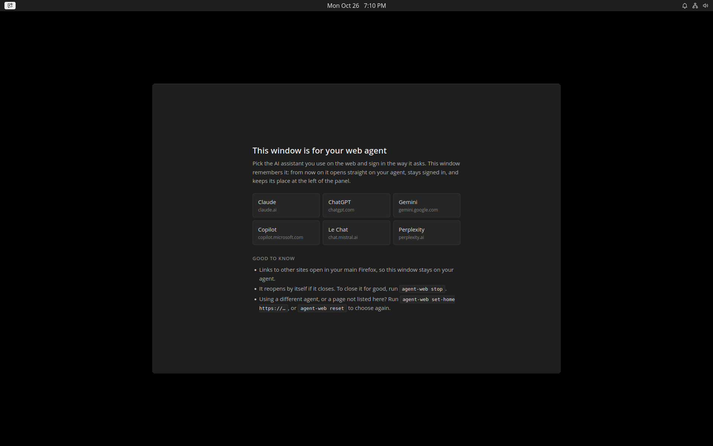
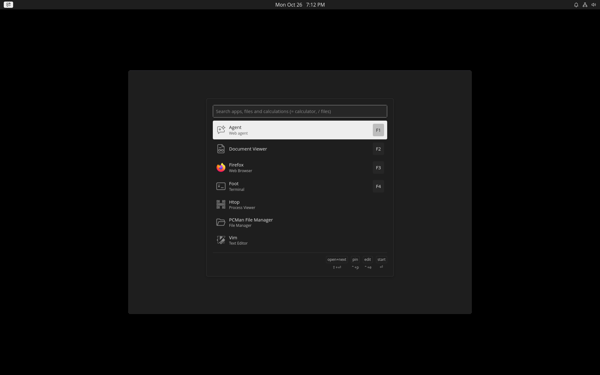
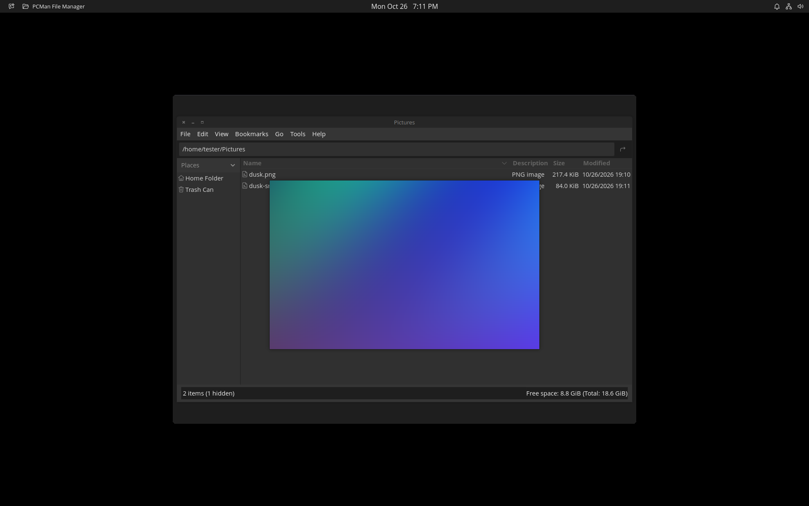
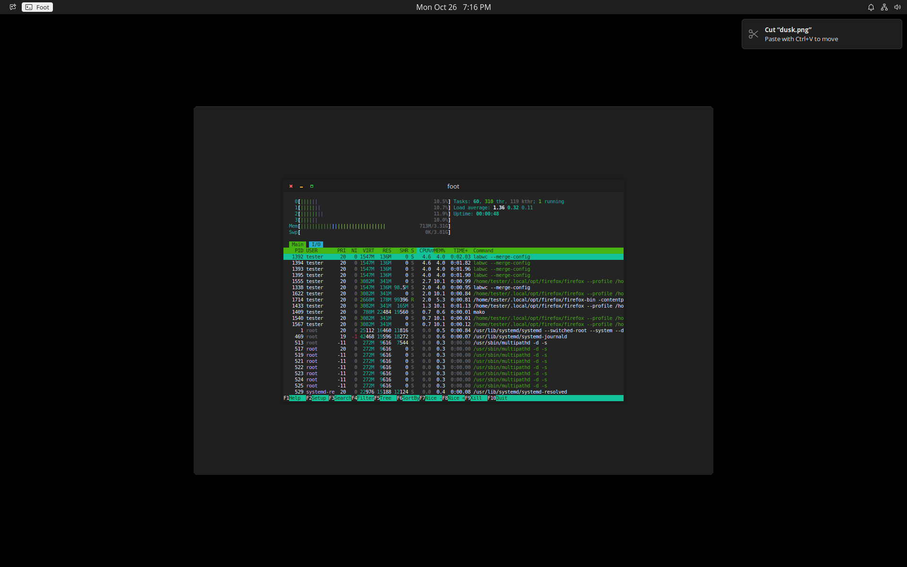
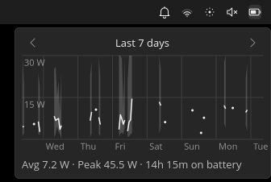

# limDE

**limDE — less is more.** A small labwc desktop for Ubuntu Server.

A small Wayland desktop for Ubuntu Server: labwc, a compact panel (Tinybar), the Walker
launcher, a consistent dark theme, Space-bar file preview in PCManFM, and a persistent
window for a web-based AI agent. Install Ubuntu Server 26.04, clone this repository,
run `./install`, and log in.

It's made for laptops first: careful with the battery, with trackpad motion and scrolling
modelled on a MacBook's.

> **Status: beta (`v1.0.0-beta.2`).** It's in daily use on one laptop, and installs from
> scratch have only been tested in QEMU and from a USB stick on that same laptop. Expect
> rough edges, and see [Known gaps](#known-gaps).

## Screenshots



| | |
| --- | --- |
|  |  |
| **Launcher:** Super+Space opens Walker for apps, files and sums. | **Files:** select a file in PCManFM and press Space to preview it. |
|  |  |
| **Terminal and notifications:** foot with htop, and a notification after a file is cut. | **Lock:** Super+L, or after 5 idle minutes. |



**Battery:** click the battery for its draw over the last 3 hours, 24 hours or 7 days.

Screenshots are from a clean install in a VM at 1920×1200, except the battery graph,
which needs a real battery and comes from a laptop.

## Philosophy

Two goals shaped limDE from the start, and they come before everything else:

- **Keep battery drain low, and visible.** On a laptop, every background process,
  wake-up and service costs battery life. limDE starts only what the desktop needs (no
  display manager, no extra services, no recommended-package extras), and it puts the
  numbers in front of you: Tinybar shows the battery's live draw in watts and the hours
  left, and colours the battery icon as the draw climbs, so you can see how fast the
  battery is draining and notice when the draw jumps. Hover over the battery for CPU
  and RAM use too, and click it for a graph of the draw over the last 3 hours, 24 hours
  or 7 days. After 5 idle minutes the screen locks, and after 8 a laptop on battery
  suspends.
- **Trackpad motion and scrolling that feel like a MacBook.** Slow, precise pointer
  movement that speeds up smoothly, and two-finger scrolling that follows your fingers.
  That needs labwc's custom acceleration and scroll curves, which is why labwc is built
  from source: the newest pointer-acceleration and scrolling work is often not in a
  release or in Ubuntu's package yet. limDE ships tuned curves, turned on for touchpads.

Memory use, measured on the Dell XPS 15 9520 described under
[Known gaps](#known-gaps) with only the agent window open (proportional set size, so
shared pages are split between the processes that use them):

| | Memory |
| --- | --- |
| The desktop: labwc, Tinybar, Walker and Elephant, Mako, swayidle | about 240 MiB |
| Session services: PipeWire, D-Bus, keyring, GVfs, the user's systemd | about 50 MiB |
| The agent window (Firefox, just started on a new claude.ai conversation) | about 1.1 GiB |
| The whole system in use, including a Claude Code CLI session | about 3.0 GiB of 16 GB |

Most of it is the browser, and it grows with the conversation: with one long claude.ai
conversation the agent window took 1.2 to 1.8 GiB, and Firefox keeps that memory until the
window restarts (`agent-web stop; agent-web`). The desktop itself is a few hundred MiB.

And three habits that follow from those goals:

- **Minimal, but not dogmatic.** The installer lists every package it wants, with the
  reason for it, before installing anything. Optional pieces are optional, and you choose
  them.
- **Built from source only where it matters.** labwc is built from a pinned upstream
  commit, for the curves above. Everything else comes from Ubuntu or from pinned upstream
  releases.
- **Yours to change.** Shipped defaults sit apart from your own changes, so updates
  don't overwrite them.

## Install

You need a fresh **Ubuntu Server 26.04** (x86_64) install, a normal user with `sudo`, and a
network connection. Choose no extra snaps or server roles in Ubuntu's installer.

1. Log in on the text console and clone this repository:

   ```
   git clone https://github.com/kgagne/limde.git
   cd limde
   ```

2. See the plan without changing anything:

   ```
   ./install --plan
   ```

3. Install. The installer shows each package and its reason, asks about the optional
   parts, then installs. labwc, PCManFM and the launcher are built from source, which takes
   a while (about 20–40 minutes on a slow disk).

   ```
   ./install
   ```

4. Log out and back in on tty1. labwc starts by itself; there is no display manager.

Wi-Fi: if Ubuntu's installer didn't join a network, run `nmtui` in a terminal once.
NetworkManager remembers it after that.

### Optional parts

| Group | Adds | Pick it when |
| --- | --- | --- |
| `laptop` | `brightnessctl` | the machine has a screen backlight; without it the brightness keys do nothing |
| `papers` | GNOME Papers | you want a PDF and document viewer |
| `printing` | CUPS, Avahi | you print, including to network printers |

The interactive installer suggests `laptop` when it finds a backlight. For unattended
installs, name the groups yourself:

```
./install --yes --with=laptop,papers
```

If you install from a VM onto a USB stick or another disk for a laptop, add
`--with=laptop`: the VM has no backlight, so it won't be suggested.

## Using it

| Keys | Does |
| --- | --- |
| Super+Return | terminal (foot) |
| Super+Space | launcher (Walker): apps, files, calculator |
| Super+L | lock the screen |
| Super+W / Super+Q | close the tab or window / quit the app |
| Super+Escape | pass every key to the focused window (VMs, remote desktops); press again to undo |
| Print / Shift+Print | screenshot a region / the whole screen, saved and copied |
| Ctrl+Print | copy a region to the clipboard only |
| Volume and brightness keys | change them, with a short readout in the panel |

In PCManFM, press Space to preview the selected files, or, with nothing selected, the
file under the keyboard focus outline.

### The agent window

**agent-web** is the window at the left of the panel: your web AI agent, kept open as
part of the desktop instead of as one tab among many. On first start it shows a page of
common web agents. Open yours and sign in. After that the window keeps to that site,
reopens if it is closed, ignores the close keys, and sends every other link to your main
Firefox.

It's meant for an agent you use all day: a chat you keep coming back to, or a
long-running session you check on and steer, such as a coding agent at work on this or
another machine. `agent-web set-home URL` opens it straight on one page, such as a
particular session.

**Why not a desktop app?** Many web agents have no official Linux app, and the apps and
wrappers that do exist usually bundle their own browser engine to show the same website.
agent-web uses the Firefox that limDE already installs, in a separate profile. There is
nothing more to install or keep updated, you get the same features as the website, and the
agent's sign-in stays apart from your everyday browsing. It still uses a Firefox
process's memory while it's open. What a website can't do is reach your files, code or
system, which is the usual reason to want a desktop app. A command-line agent covers that
instead (next).

**With a CLI agent on the machine.** A command-line agent works directly in your code,
files and system, and some can be driven from their website. Claude Code, for example,
has Remote Control: start `claude --remote-control` (or type `/rc` in a running session)
and the session appears on claude.ai, where the agent window can steer it. Run the CLI in
tmux, which limDE installs, so it keeps going when no terminal is open and you can still
attach to it locally. The agent window becomes the front end, and the CLI does the local
work with its own permission prompts. Together they do what a desktop app would, without installing one,
and the same session can be reached from your phone. This isn't part of limDE: the CLI,
its account and its permissions are yours to choose. To keep one running from boot, a
user unit such as this works (with `loginctl enable-linger` so it starts without a login):

```ini
# ~/.config/systemd/user/agent-cli.service
[Unit]
Description=CLI agent with Remote Control, in tmux (attach: tmux -L agent attach)

[Service]
Type=forking
WorkingDirectory=%h
ExecStart=/usr/bin/tmux -L agent new-session -d -s agent %h/.local/bin/claude --remote-control
ExecStop=/usr/bin/tmux -L agent kill-server
Restart=always
RestartSec=30

[Install]
WantedBy=default.target
```

If you'd rather use a desktop app anyway, turn agent-web off as
`components/agent-web/README.md` describes.

## Customizing

Your own files override limDE's, and the installer never overwrites them:

- **labwc:** put only the settings you change in `~/.config/labwc/rc.xml`. labwc merges it
  over limDE's defaults in `/etc/xdg/labwc/`.
- **Session start:** add scripts to `~/.config/limde/autostart.d/`. A file with the
  same name as one of limDE's replaces it, and an empty one turns that piece off.
- **Theme:** colours, fonts and icons live in `~/.config/limde/appearance.toml`, which
  needs only the keys you change. `limde-appearance` shows what would change, and
  `limde-appearance --apply` writes it, backing up what it replaces.
- **Panel:** `~/.config/tinybar/settings.toml` (see `components/tinybar/README.md`).

## Updating

```
git pull
./install
```

Running `./install` again is safe. Each step checks first and only changes what is missing
or out of date, including the pinned source builds in `pins/`.

## Known gaps

- In daily use on one laptop: a Dell XPS 15 9520 (Intel Core i7-12700H, 16 GB RAM,
  Intel Iris Xe plus an NVIDIA GeForce RTX 3050 Laptop GPU, 512 GB NVMe SSD). That
  laptop runs limDE's components with its owner's personal settings on top, including
  NVIDIA's own driver, so sound, suspend and resume, the lid and the battery readout are
  exercised there every day.
- Not yet tested from scratch on any other hardware. A fresh `./install` has been tested
  only in QEMU and from a USB stick booted on that same laptop, not on a laptop's
  internal drive.
- The trackpad curves were tuned on one laptop's touchpad and may feel different on
  yours. To change them, copy the whole `<device category="touchpad">` block from
  `/etc/xdg/labwc/rc.xml` into `~/.config/labwc/rc.xml` and edit it there; your block
  replaces limDE's entirely. For libinput's default motion, use
  `<accelProfile>adaptive</accelProfile>` and remove the curve lines.
- Tinybar's Wi-Fi list is display-only. Join networks with `nmtui`.
- On NVIDIA laptops, the desktop runs on the integrated GPU. The NVIDIA card is left to
  Ubuntu's open nouveau driver; limDE doesn't set up NVIDIA's driver.
- There is no uninstaller yet.
- Ubuntu 26.04 only.

Bug reports are welcome. Please include your hardware and the output of
`journalctl -b -p warning`.

## How this was made

limDE grew out of one person's daily-driver laptop setup. It was designed, tested
and directed by its author over many iterations, and much of the implementation, review
and documentation was done with AI coding tools working from that guidance. Without that
tooling, a project of this scope would not have been practical for one person. Every
change was steered and accepted by a human, and tested on real hardware and in VMs.

## Licence

MIT for limDE's own code (see `LICENSE`). Some files come from or patch other
projects and keep their own licences; `REUSE.toml` lists them.
